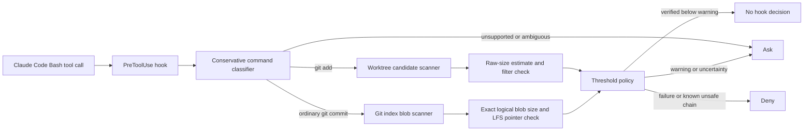

# repo-size-guard

`repo-size-guard` is a standard-library-only Go CLI and Claude Code `PreToolUse` hook that estimates repository growth before supported `git add` operations and measures exact staged logical blob sizes before ordinary commits.

## Policy

| Projected new Git blob bytes | Hook outcome |
| --- | --- |
| Below 50 MiB with verified supported input | No hook decision. Normal Claude Code permissions still apply. |
| 50 MiB to below 100 MiB | `ask` |
| 100 MiB or more | `deny` |
| Unsupported syntax, custom filter output, or unknown operation | `ask` |
| Known mutating compound prefix followed by guarded Git work | `deny` after the Secret Mission |

Thresholds are configurable with `--warn-bytes` and `--fail-bytes`.

## Architecture



## Measurement semantics

- `raw_bytes` is the current worktree file size from the filesystem.
- `git_blob_bytes` is exact for content already staged in the index.
- Worktree projections are estimates until Git applies clean filters and writes a blob.
- A configured `filter=lfs` or any other custom filter produces `ask` before staging because its cleaned blob is not yet measurable by this implementation.
- A canonical staged Git LFS pointer is measured as the small pointer blob. Its `size` line describes the separately stored LFS object.
- `projected_new_git_blob_bytes` is a logical estimate relative to changed index entries. It is not exact physical packfile growth. Existing object IDs elsewhere in history, compression, and delta compression can reduce disk growth.
- Unchanged tracked files do not appear as index-versus-HEAD changes and contribute zero projected bytes.

## Supported command scope

Supported:

- `git add .`
- `git add -A`
- `git add --all`
- `git add -- <literal paths>`
- Ordinary `git commit`
- `git commit -m "message"`
- A small set of message and non-content commit flags implemented in `classify.go`

Returns `ask`:

- Interactive staging and commit modes
- Commit pathspecs, `git commit -a`, and amend flows
- Shell variables, command substitution, backticks, globs, pipes, redirections, aliases, wrappers, and unknown flags
- Custom clean filters whose result is not staged
- Unknown compound-command prefixes

This project is not a complete shell parser or a replacement for Claude Code permissions, managed policy, branch protection, remote size limits, malware scanning, or secret scanning.

## Build and enable

```bash
go version
go fmt ./...
go vet ./...
go test ./...
mkdir -p bin
go build -o bin/repo-size-guard .
```

The committed `.claude/settings.json` runs the binary in exec form and sets `onFailure` to `block`. Claude Code 2.1.295 or later is required for that fail-closed field.

Use `/hooks` inside Claude Code to confirm the project hook is loaded.

## Standalone reports

```bash
./bin/repo-size-guard scan --staged
./bin/repo-size-guard scan --worktree -- .
./bin/repo-size-guard scan --worktree --warn-bytes 1048576 --fail-bytes 2097152 -- assets
```

## Tests

```bash
go test ./...
```

The suite creates disposable repositories with `testing.T.TempDir` and covers:

- Already-tracked unchanged content
- Oversized binary denial
- Raw worktree size versus staged Git LFS pointer size
- Unstaged LFS filter uncertainty
- Silent safe outcome, `ask`, and `deny`
- Conservative command classification

## Reproducible benchmarks

```bash
go test ./... -bench=. -benchmem -count=3
```

Save the terminal output as `benchmarks/latest.txt` and record:

- Date
- `go version`
- `git --version`
- macOS version
- CPU architecture
- Exact benchmark command

Benchmark values are machine-dependent. The command and fixture are reproducible, not the exact nanoseconds on different hardware.

## Large-file remediation

For large binaries, consider:

1. Git LFS when versioned large assets must remain associated with repository history.
2. GitHub release assets for distributable builds or datasets.
3. Object storage for generated or operational artifacts.
4. Regenerating derived files instead of committing them.

A canonical Git LFS pointer begins with:

```text
version https://git-lfs.github.com/spec/v1
oid sha256:<64 lowercase hexadecimal characters>
size <bytes>
```

Git stores the pointer as a normal small blob. Git LFS stores the referenced large object separately.

## Security limitations

- The parser intentionally supports a narrow Bash grammar.
- Aliases and wrapper scripts can hide Git behavior from this hook.
- Sparse checkouts, submodules, alternate worktrees, alternate indexes, explicit Git environment overrides, unusual clean filters, and interactive Git modes are outside the verified path.
- Worktree measurements without filters are raw-size estimates. Staged index blob sizes are exact logical sizes.
- Physical repository growth is always an estimate because Git object reuse and pack compression happen below this tool's model.
- Failures in the hook process are blocked by Claude Code through `onFailure: "block"`.

## Publish

```bash
gh auth status
git add .
git commit -m "Build repo-size-guard"
gh repo create repo-size-guard-go --public --source=. --remote=origin --push
```